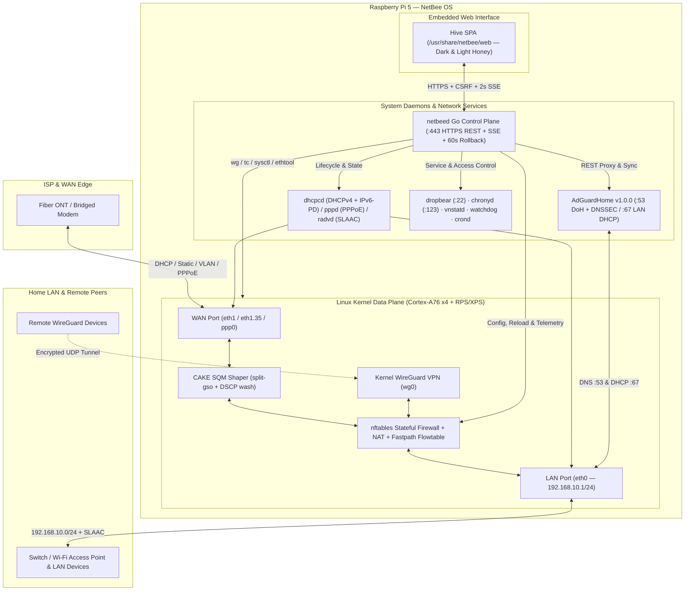

<div align="center">


# NetBee OS

**Minimal, Hardened Gigabit Firewall & Router OS for Raspberry Pi 5**  
*Powered by the `netbeed` Go Control Plane & the 100% Offline **Hive** Web Interface*

[-EAAF24?style=flat-square&logo=raspberrypi&logoColor=white)](#stage-1--hardware--physical-topology)
[-32383E?style=flat-square&logo=linux&logoColor=F5D36B)](#repository-architecture)
[-EAAF24?style=flat-square&logo=go&logoColor=111315)](netbee-external/package/netbeed/API.md)
[-22262A?style=flat-square&logoColor=EAAF24)](#meet-hive--the-integrated-web-control-plane)
[](#system-architecture)
[](#core-capabilities)

[**Overview**](#overview) · [**Architecture**](#system-architecture) · [**Hive Web UI**](#meet-hive--the-integrated-web-control-plane) · [**Step-by-Step Guide**](#step-by-step-guide-from-source-to-live-router) · [**QEMU Lab**](#virtual-router-lab-testing-in-qemu-arm64) · [**CLI & API**](#cli-utilities--restsse-api) · [**Repository**](#repository-architecture)

</div>

---

## Overview

**NetBee OS** is a purpose-built, headless Linux router and stateful firewall distribution engineered specifically for the **Raspberry Pi 5**. Built cleanly on an untouched upstream **Buildroot 2026.08.2** tree (`BR2_EXTERNAL`), it pairs a lean Linux kernel data plane (`nftables`, software flowtable offloading, multi-core RPS/XPS steering, CAKE SQM, and kernel WireGuard) with **`netbeed`** — a zero-dependency Go management daemon — and **Hive**, a cohesive *Honey & Obsidian* single-page web interface served entirely offline from the appliance.

### Core Design Pillars

- **Plug-and-Play Gigabit & 2.5GbE Throughput**: Ships with bundled Realtek USB/PCIe NIC microcode (`RTL8152`/`8153`/`8156`/`8168`/`8125`), automatic multi-core **RPS/RFS/XPS packet steering** across all four Cortex-A76 cores (`arm_boost=1`), bidirectional TCP MSS clamping, and `nftables` `fastpath` software flow offloading across DHCP, Static, 802.1Q VLAN, and PPPoE WAN links.
- **Dynamic Home-Router Flexibility**: Reassign physical Ethernet ports, perform atomic **LAN ↔ WAN swaps**, stack **802.1Q Fiber ONT VLAN tags** (e.g., `VLAN 35`) orthogonally over `DHCP`, `Static IPv4`, or `PPPoE`, pin MAC addresses via `udev`, and tune `ethtool` offloads or Jumbo/Baby-Jumbo MTUs directly from **Hive**.
- **60-Second Anti-Lockout Safety**: Every potentially disruptive change to LAN addressing, WAN topology, NIC link speed, or firewall rulesets is guarded by an automatic **60-second rollback timer** — if browser connectivity is lost and not confirmed, `netbeed` atomically restores the last working state.
- **100% Offline, Self-Contained Control Plane**: Zero cloud dependencies, zero external CDN/font requests, and zero bloated scripting runtimes on target. **Hive** (HTML/CSS/JS + local fonts & icons) is embedded into `/usr/share/netbee/web` and served over HTTPS (`:443`) with CSRF protection and 2-second Server-Sent Events (SSE) telemetry.
- **Appliance Hardening & Flash Longevity**: Default-drop `input`/`forward` firewall policy, server-only `dropbear` SSH bound strictly to the LAN IP, compile-time removal of weak/legacy OpenSSL ciphers, hardware watchdog (`/dev/watchdog`), `noatime` ext4 rootfs, and RAM-backed `/var/log` (`tmpfs`) with hourly `logrotate`.

---

## System Architecture



---

## Meet Hive — The Integrated Web Control Plane

<div align="center">
  
  <p><strong>Hive</strong> is NetBee's bespoke web management console — crafted with a high-contrast <em>Dark Honey</em> &amp; <em>Light Honey</em> token system, keyboard-first navigation (<code>Ctrl+K</code> Command Palette, <code>Alt+T</code> theme switch, <code>[</code> sidebar collapse), live 2-second SSE charts, and real-time staged rollback indicators.</p>
</div>

| Navigation Group | Module | Route | Capabilities |
| :--- | :--- | :--- | :--- |
| **Overview** | **System Overview** | `#/overview/system` | Live RPi 5 CPU load/MHz/governor, SoC thermal & Active Cooler PWM fan RPM, PSU undervoltage alarm, RAM/partition usage, WAN/LAN live throughput charts, and gateway health. |
| **Overview** | **Flow Summary** | `#/overview/flows` | Real-time `nf_conntrack` active NAT/session table, protocol distribution, state filtering, single-connection termination, and full table flush. |
| **Network** | **Interfaces** | `#/network/interfaces` | Dynamic LAN/WAN port selection, atomic **Swap LAN ↔ WAN**, orthogonal **802.1Q VLAN** + `DHCP` / `Static IPv4` / `PPPoE`, custom WAN DNS (`peerdns`), MAC cloning & `udev` pinning, LAN Jumbo MTU (`9000`) / Baby Jumbo (`1508`), per-port `UP`/`DOWN`, custom labels, and `ethtool` speed/WoL/offloads. |
| **Network** | **Routing & Gateways** | `#/network/routing` | Active IPv4/IPv6 kernel routing tables, persisted static routes, Longest-Prefix-Match (LPM) route lookup tester, and live ARP / IPv6 NDP neighbor cache. |
| **Network** | **DHCP & DNS** | `#/network/services` | `AdGuardHome` LAN DHCP pool & lease time, active leases, static `MAC → IP` reservations, upstream DoH/DoT resolvers (`parallel` / load-balance / fastest), and local DNS rewrites. |
| **Network** | **SQM QoS** | `#/network/sqm` | **CAKE** anti-bufferbloat queue management (`netbee-sqm`), automatic `ethX` / `ethX.<vid>` / `ppp0` resolution, `split-gso`, ingress DSCP `wash`, and Fiber/PPPoE/Ethernet overhead presets. |
| **Network** | **Diagnostics** | `#/network/diagnostics` | Live `ping`, JSON `mtr` traceroute, `nslookup` DNS probe, bounded `tcpdump` packet capture, `iperf3` client tests, and a temporary TTL-guarded local `iperf3 -s` server. |
| **Security** | **Firewall Rules** | `#/security/firewall` | Stateful `nftables` `input`/`forward` rules, software `flowtable` offload toggle, transparent LAN DNS `:53` redirect, dry-run validated (`nft -c`) raw `.nft` snippet editor, and live JSON ruleset viewer. |
| **Security** | **NAT & Port Forward** | `#/security/nat` | Inbound WAN port & `1:1` port-range forwarding (`DNAT`) with TCP/UDP/Both matching, optional source CIDR allowlists, and WAN masquerade status. |
| **Security** | **WireGuard VPN** | `#/security/vpn` | Kernel `wg0` server setup, automatic firewall port sync, one-click Curve25519 + optional PresharedKey peer provisioning, live handshake/transfer stats, and instant `.conf` download. |
| **Security** | **Ad/Tracker Block** | `#/security/adblock` | `AdGuardHome` blocklist subscriptions, custom allow/block rules, one-click service blocking (YouTube, TikTok, Discord, etc.), DNSSEC toggle, 64 MB optimistic cache control, and live RAM query log. |
| **System** | **General & Services** | `#/system/settings` | Appliance hostname, timezone (`tzdata`), `chronyd` NTP client & LAN time server, lifecycle control for all 17 OS daemons, whitelisted `crond` task scheduler, `sysctl` kernel tuning, reboot & clean shutdown. |
| **System** | **Users & Access** | `#/system/access` | Web (`admin`) and OS (`root`, `netbee`) SHA-512/bcrypt password rotation, Dropbear SSH policy (`password_auth`, `allow_root_login`, idle timeout), per-user `authorized_keys`, and custom X.509 PEM TLS certificate upload. |
| **System** | **System & Backup** | `#/system/firmware` | NetBee OS build & kernel metadata, full `.tar.gz` configuration snapshot download (`netbee-backup`), and zip-bomb/symlink-verified archive restore. |
| **System** | **Service Logs** | `#/system/service-logs` | Live `/var/log/messages` RAM syslog viewer with keyword filtering, immediate `logrotate`, safe in-place truncation, and CSV export. |
| **System** | **Kernel Logs** | `#/system/kernel-logs` | Linux `dmesg` ring buffer inspector for NIC carrier transitions, `nftables`, WireGuard, USB/PCIe enumeration, and thermal events. |

---

## Core Capabilities

| Subsystem | Implementation Highlights |
| :--- | :--- |
| **Firewall & Fastpath (`nftables`)** | Default-drop `input` & `forward` chains, invalid-state drop, SSH brute-force rate limiting, bidirectional TCP MSS clamping (`oifname` & `iifname`), WireGuard (`wg0`) zone, and dual-stack `fastpath` software `flowtable` (`tcp`/`udp`) supporting plain Ethernet, 802.1Q VLAN, and PPPoE (`ppp0`) when SQM is disabled. |
| **Multi-Core Packet Steering** | `S18packet-steering` (`netbee-packet-steering`) distributes NIC RX/TX queues across Cortex-A76 cores (`RPS` mask `0xe` + `RFS` `32768` entries + `XPS`), automatically re-applied on hotplug, physical carrier recovery, and PPPoE `ip-up`. |
| **DNS & DHCP (`AdGuardHome`)** | Single unified daemon handling encrypted upstream DNS (`parallel` DoH + `64 MB` cache + `DNSSEC` + bootstrap IP fallback to prevent 1970 RTC cold-boot deadlocks) and LAN DHCP (`192.168.10.100–200`); `dnsmasq` is intentionally omitted. |
| **WAN Resilience & IPv6** | Fast-LCP PPPoE (`lcp-echo-interval 5`, `lcp-echo-failure 3`, `lcp-echo-adaptive`), orthogonal 802.1Q VLAN subinterfaces, `dhcpcd` DHCPv4 + DHCPv6 Prefix Delegation (`IPv6-PD`), `radvd` LAN SLAAC router advertisements, and `netbeed` physical link-carrier (`0 → 1`) auto-recovery. |
| **Hardware & Security Hardening** | Headless `config_5.txt` (`arm_boost=1`, `pciex1`, `usb_max_current_enable=1`, Wi-Fi/BT/audio disabled), `udev` rule pinning RP1 `macb` to `eth0`, `bcm2835_wdt` hardware watchdog, server-only `dropbear`, `0700`/`0600` secret permissions via `device_table.txt`, and unprivileged service accounts (`netbee` UID `1000`, `iperf` UID `110`). |

---

## Default Network & Credentials

| Interface / Service | Default Value | Notes |
| :--- | :--- | :--- |
| **LAN Interface (`eth0`)** | `192.168.10.1/24` | Built-in Raspberry Pi 5 RP1 Gigabit Ethernet (`udev`-pinned) |
| **WAN Interface (`eth1`)** | `DHCP` + `IPv6-PD` (`dhcpcd`) | USB 3.0 or PCIe Ethernet NIC (`Static`, `PPPoE`, and `802.1Q VLAN` ready) |
| **LAN DHCP Pool** | `192.168.10.100` – `192.168.10.200` | Served by `AdGuardHome` (`denyinterfaces eth0` enforced in `dhcpcd`) |
| **Hive Web UI & `netbeed` API** | `https://192.168.10.1` | Default login: **`admin`** / **`netbee`** (`:80` redirects to `:443` HTTPS) |
| **AdGuardHome Native UI** | `http://192.168.10.1:3000` | Bound strictly to LAN IP; default login: **`admin`** / **`netbee`** |
| **Dropbear SSH** | `ssh netbee@192.168.10.1` / `root@192.168.10.1` | Bound to `192.168.10.1:22`; default password: **`netbee`** |

> [!IMPORTANT]
> Change all default passwords immediately on first boot via **Hive → System → Users & Access** (which can rotate Web `admin`, `root`, and `netbee` credentials together) or by running `netbee-passwd` over SSH.

---

## Step-by-Step Guide: From Source to Live Router

### Stage 1 — Hardware & Physical Topology

#### Recommended Hardware
1. **Board**: Raspberry Pi 5 (2 GB, 4 GB, or 8 GB RAM)
2. **Cooling & Power**: Official Raspberry Pi 5 Active Cooler (monitored live via PWM fan telemetry) + Official 27W USB-C Power Supply
3. **Storage**: High-endurance microSD card (16 GB or larger)
4. **Second NIC (`eth1`)**:
   - **USB 3.0 2.5GbE / 1GbE Adapter** (plugged into a blue USB 3.0 port — Realtek `RTL8156B` / `RTL8153` microcode is pre-installed for plug-and-play operation), *or*
   - **PCIe M.2 / HAT Ethernet NIC** (`RTL8125` 2.5GbE, `RTL8168` 1GbE, etc. — PCIe Gen 2 lane is enabled by default in `config_5.txt`)

#### Physical Cabling
```text
[ Fiber ONT / Bridged ISP Modem ]
               │
               ▼  (Ethernet cable → WAN)
     ┌───────────────────┐
     │  eth1 (USB/PCIe)  │
     │                   │
     │  Raspberry Pi 5   │  NetBee OS + Hive (https://192.168.10.1)
     │                   │
     │  eth0 (Built-in)  │
     └─────────┬─────────┘
               │  (Ethernet cable → LAN 192.168.10.1/24)
               ▼
[ Unmanaged Switch / Wi-Fi Router in Access Point (AP) Mode ]
```

---

### Stage 2 — Host Prerequisites & Buildroot Setup

On an x86_64 or ARM64 Linux build machine (Ubuntu/Debian/Fedora/Arch), install standard Buildroot prerequisites (`git`, `make`, `gcc`, `g++`, `bc`, `bison`, `flex`, `libssl-dev`, `unzip`, `rsync`, `wget`, `cpio`, `file`, `python3`), then clone **NetBee** and unpack upstream **Buildroot 2026.08.2** right inside the repository root:

```bash
git clone git@github.com:yalcer/NetBee.git
cd NetBee

wget https://buildroot.org/downloads/buildroot-2026.08.2.tar.xz
tar -xf buildroot-2026.08.2.tar.xz
```

> [!NOTE]
> Upstream `buildroot-2026.08.2/` is never modified; all NetBee packages, kernel fragments, overlays, and board scripts live cleanly inside `netbee-external/` (`BR2_EXTERNAL`).

---

### Stage 3 — Configure & Compile the OS Image

Load the Raspberry Pi 5 router configuration and execute a full-core parallel build (`BR2_PER_PACKAGE_DIRECTORIES=y` with `-j$(nproc)`):

```bash
make defconfig
make build
```

When compilation finishes, Buildroot generates the bootable artifacts in `output/images/`:
- `output/images/sdcard.img` — Complete partitioned Raspberry Pi 5 microSD image (FAT32 boot firmware + ext4 rootfs)
- `output/images/Image` & `output/images/rootfs.ext4` — ARM64 Linux kernel and root filesystem (also directly bootable in QEMU)

---

### Stage 4 — Flash `sdcard.img` to microSD

Write the image using **Raspberry Pi Imager** (*Choose OS → Use custom → select `output/images/sdcard.img`*, *skip OS customisation*), or flash directly from the Linux terminal:

```bash
# Replace /dev/sdX (or /dev/mmcblkX) with your microSD block device!
sudo dd if=output/images/sdcard.img of=/dev/sdX bs=4M status=progress conv=fsync
sync
```

---

### Stage 5 — First Boot & Automatic Provisioning

Insert the microSD card into the Raspberry Pi 5, connect **LAN (`eth0`)** and **WAN (`eth1`)**, and apply power. On first boot, NetBee OS automatically performs:

1. **Full Storage Expansion (`S12firstboot-resize`)**: Resizes partition 2 and runs online `resize2fs` so the `ext4` root filesystem utilizes 100% of your microSD card.
2. **Hardware Watchdog & Multi-Core Steering (`S15watchdog`, `S18packet-steering`)**: Arms `/dev/watchdog` and spreads network interrupt/packet processing across CPU cores.
3. **Deterministic NIC Naming (`udev`)**: Pins the built-in RP1 Ethernet controller (`macb`) to `eth0` (`192.168.10.1/24`) so USB/PCIe adapters never steal the LAN role across reboots.
4. **Cold-Boot Resilient DNS & DHCP (`S85adguardhome`)**: Assigns `192.168.10.100–200` to LAN devices and resolves DNS immediately (using IP bootstrap fallbacks until `chronyd` completes NTP clock sync).
5. **TLS Provisioning (`S90netbeed`)**: Generates a unique ECDSA P-256 self-signed HTTPS certificate in `/etc/netbee/tls/` and brings up **Hive** on `https://192.168.10.1`.

---

### Stage 6 — Sign In to Hive & Lock Down Access

1. From any device connected to `eth0` (or your LAN Wi-Fi AP), open **`https://192.168.10.1`** in your browser and proceed past the initial self-signed certificate prompt.
2. Sign in with **`admin`** / **`netbee`**.
3. Navigate to **System → Users & Access** (`#/system/access`):
   - Set a strong new password and keep **Sync `root` & `netbee` OS/SSH passwords** checked so Web and SSH credentials rotate together.
   - *(Recommended)* Paste your workstation's `ssh-ed25519` public key under **SSH Authorized Keys**, verify key-based login (`ssh netbee@192.168.10.1`), and disable SSH password authentication or direct `root` SSH login.
   - *(Optional)* Upload your own internal CA or Let's Encrypt PEM certificate + private key under **HTTPS TLS Certificate**.

---

### Stage 7 — Configure Your ISP WAN Mode

Navigate to **Network → Interfaces** (`#/network/interfaces`) to match your ISP topology:

- **Scenario A — Cable / Bridged Router (`DHCP`, Default)**:
  - Works out of the box with zero configuration! Plug your modem into `eth1` to obtain an IPv4 lease and IPv6 Prefix Delegation (`IPv6-PD`) automatically.
- **Scenario B — Direct Fiber ONT (`PPPoE` + `802.1Q VLAN`, e.g., VLAN 35)**:
  1. In the **WAN Configuration** card, choose protocol **`PPPoE`**.
  2. Toggle **Enable 802.1Q VLAN Tagging** on and enter your ISP's VLAN ID (e.g., `35`).
  3. Enter your ISP **PPPoE Username** and **Password** (MTU defaults to `1492`, or up to `1500` with `1508` Baby Jumbo if supported by your ONT).
  4. Click **Save & Apply WAN**, then click **Confirm Changes** in the top rollback banner within 60 seconds.
- **Scenario C — Static IPv4 or Port Reassignment (`Swap LAN ↔ WAN`)**:
  - Select **`Static IP`** to specify a fixed WAN IPv4 address, netmask, gateway, and custom DNS resolvers (`peerdns` off).
  - Want to use a 2.5GbE USB/PCIe adapter as your internal LAN port and the built-in 1GbE port for WAN? Click **Swap LAN ↔ WAN** for an atomic, rollback-protected role exchange.

---

### Stage 8 — Enable SQM/CAKE, Ad Blocking, WireGuard & Backups

1. **Eliminate Bufferbloat (`Network → SQM QoS`)**:
   - Enable **CAKE** when you want ultra-low latency under heavy load (set Download/Upload to ~90–95% of measured line speed; choose overhead `44` for Fiber PPPoE+VLAN or `18`/`22` for Ethernet). Leave SQM disabled on symmetric multi-gigabit links if you prefer maximum zero-CPU `nftables` `flowtable` fastpath throughput.
2. **Network-Wide Ad & Tracker Blocking (`Security → Ad/Tracker Block`)**:
   - Enable curated DNS blocklists, toggle one-click service blocks, or add custom domain rules. Optionally enable **Transparent DNS Redirect** in **Security → Firewall Rules** so hardcoded client DNS queries (`8.8.8.8`) are intercepted on LAN `:53`.
3. **Remote Access VPN (`Security → WireGuard VPN`)**:
   - Enable `wg0` (default `10.99.0.1/24` on UDP `:51820`), set your public WAN hostname/IP as the endpoint, click **Add Peer** to generate a client configuration with PresharedKey protection, and import the downloaded `.conf` into the official WireGuard app.
4. **Save a Verified Backup (`System → System & Backup`)**:
   - Click **Download Backup (`.tar.gz`)** to archive `/etc/netbee/`, `/etc/nftables*`, `/etc/AdGuardHome.yaml`, WireGuard keys, static routes, DHCP reservations, and SSH settings.

---

## Virtual Router Lab: Testing in QEMU (ARM64)

You can boot and test the full NetBee OS stack — including **Hive**, **`netbeed`**, **`AdGuardHome`**, **`nftables`**, and **Dropbear SSH** — on your PC without Raspberry Pi hardware (`qemu-system-aarch64` and `qemu-img` required):

```bash
make qemu
```

`scripts/run-qemu.sh` wraps `output/images/rootfs.ext4` in a temporary `/tmp/*.qcow2` copy-on-write overlay (leaving your build image untouched) and launches a 4-core Cortex-A76 VM (`1024 MB` RAM) with dual VirtIO NICs:

| Virtual Endpoint | Host Access | Inside QEMU VM | Credentials / Notes |
| :--- | :--- | :--- | :--- |
| **Hive Web UI & `netbeed` API** | `https://127.0.0.1:8443` | `192.168.10.1:443` (`eth0`) | `admin` / `netbee` |
| **AdGuardHome Native UI** | `http://127.0.0.1:3000` | `192.168.10.1:3000` (`eth0`) | `admin` / `netbee` |
| **Dropbear SSH** | `ssh -p 2222 root@127.0.0.1` | `192.168.10.1:22` (`eth0`) | Password: `netbee` (or `netbee@127.0.0.1`) |
| **Serial Console (`ttyAMA0`)** | Attached to current terminal | PL011 UART `115200` | Press `Ctrl+A`, then `X` to exit QEMU |
| **Simulated ISP WAN (`eth1`)** | QEMU user-mode NAT | `10.0.2.15/24` via `dhcpcd` | Full outbound internet & DNS reachability |

---

## CLI Utilities & REST/SSE API

### Built-in Router Administration Tools (`/usr/sbin/`)

| Command | Purpose |
| :--- | :--- |
| `netbee-cli` | Interactive console dashboard & menu for WAN, LAN, firewall, SQM, passwords, and backups |
| `netbee-status` | One-shot system health summary (board temp/fan, uptime, interface IPs, gateways, active daemons) |
| `netbee-passwd` | Synchronized password updater for OS (`root` / `netbee`) and service accounts |
| `netbee-user` | Manage SSH `authorized_keys` and inspect local appliance user accounts |
| `netbee-sqm` | Apply, stop, or inspect CAKE ingress (`ifb4*`) & egress traffic shaping (`start` / `stop` / `status`) |
| `netbee-packet-steering` | Configure multi-core RPS, RFS, and XPS queue masks across active network interfaces |
| `netbee-backup` | Create or restore verified `.tar.gz` configuration archives from the command line |
| `netbee-factory-reset` | Wipe mutable configurations and return the appliance cleanly to factory defaults |

### `netbeed` HTTPS REST & SSE API

Every action in **Hive** is backed by a clean JSON API under `/api/v1/*` (authenticated via `netbee_session` + `X-CSRF-Token` or `Authorization: Bearer <token>`):

```bash
# Public health probe
curl -sk https://192.168.10.1/api/v1/health

# Authenticate and capture Bearer token
TOKEN=$(curl -sk -X POST https://192.168.10.1/api/v1/auth/login \
  -H "Content-Type: application/json" \
  -d '{"username":"admin","password":"YOUR_PASSWORD"}' | sed -n 's/.*"token":"\([^"]*\)".*/\1/p')

# Query live Raspberry Pi 5 hardware, thermal, storage & service overview
curl -sk https://192.168.10.1/api/v1/system/overview -H "Authorization: Bearer $TOKEN"
```

See the complete endpoint specification in **[`netbee-external/package/netbeed/API.md`](netbee-external/package/netbeed/API.md)**.

---

## Boot Sequence & Service Lifecycle

NetBee OS uses deterministic SysV init scripts (`/etc/init.d/S*`) for sub-10-second headless boot times:

| Order | Init Script / Service | Role on Boot |
| :---: | :--- | :--- |
| `S12` | `S12firstboot-resize` | Expands microSD partition 2 + `ext4` rootfs on initial boot |
| `S15` | `S15watchdog` | Starts hardware watchdog daemon on `/dev/watchdog` |
| `S18` | `S18packet-steering` | Enables multi-core RPS/RFS/XPS packet steering across Cortex-A76 cores |
| `S35` / `S42` | `S35nftables` + `S42nft-offload` | Loads `/etc/nftables.conf` default-drop ruleset and enables `fastpath` flowtable |
| `S40` / `S41` | `S40network` + `S41dhcpcd` | Brings up LAN/WAN/VLAN links and starts WAN DHCPv4 / DHCPv6-PD |
| `S45` | `S45sqm` | Applies CAKE ingress/egress queue disciplines if enabled in `/etc/netbee/sqm.conf` |
| `S49` | `S49chrony` | Synchronizes system clock via NTP and serves time to LAN clients |
| `S50` | `S50dropbear` + `S50radvd` | Starts LAN-bound SSH server (`:22`) and IPv6 Router Advertisements |
| `S85` | `S85adguardhome` | Starts encrypted DNS resolver (`:53`), ad-blocking engine, and LAN DHCP server (`:67`) |
| `S86` | `S86vnstatd` | Records persistent low-overhead bandwidth history in SQLite |
| `S90` | `S90netbeed` | Restores persisted runtime state (WireGuard, static routes, `ethtool`, custom `udev` rules), starts physical carrier monitor, and serves **Hive** + `/api/v1/*` on `:443` |

---

## Repository Architecture

```text
NetBee/
├── Makefile                              # Top-level Buildroot & QEMU workflow wrapper
├── README.md                             # Project documentation & step-by-step guide
├── scripts/
│   └── run-qemu.sh                       # Non-destructive ARM64 QEMU virtual router launcher
├── hive/                                 # Offline-bundled Hive Web UI SPA
│   ├── index.html                        # Login gate + main responsive control plane shell
│   ├── design-system.html                # Honey & Obsidian UI token & component reference
│   └── assets/
│       ├── css/                          # Design tokens, Dark/Light Honey themes & layout CSS
│       ├── img/                          # Vector honeycomb logo marks & favicon (SVG)
│       ├── js/core/                      # Router, reactive store, SSE/REST client, charts & validators
│       ├── js/data/                      # Domain service adapters mapped to netbeed /api/v1/*
│       ├── js/modules/                   # 16 live management views (Interfaces, Firewall, VPN, SQM...)
│       └── vendor/                       # Offline-bundled Fomantic-UI, Lucide icons & WOFF2 fonts
└── netbee-external/                      # Out-of-tree Buildroot customization (BR2_EXTERNAL)
    ├── external.desc & external.mk       # NETBEE external tree metadata
    ├── Config.in                         # External package menu definitions
    ├── configs/
    │   └── netbee_rpi5_defconfig         # Hardened Raspberry Pi 5 router Buildroot defconfig
    ├── package/
    │   ├── adguardhome/                  # AdGuardHome v1.0.0 package, SHA256 verification & S85 init
    │   └── netbeed/                      # Go HTTPS/SSE backend daemon, unit tests & API.md reference
    └── board/netbee/rpi5/
        ├── config_5.txt                  # Headless RPi 5 boot firmware config (arm_boost=1, pciex1)
        ├── linux-netbee.fragment         # Kernel config (nftables, flowtable, CAKE, WireGuard, NICs, VirtIO)
        ├── busybox-netbee.fragment       # Hardened BusyBox applets (SHA-512 chpasswd, tar-gz, stat)
        ├── users.table                   # Pre-provisioned OS accounts ('netbee' UID 1000, 'iperf' UID 110)
        ├── device_table.txt              # Fakeroot strict 0700/0600 ownership & secret permissions
        ├── post-build.sh                 # Build stamp (/etc/os-release) & executable script verification
        └── rootfs-overlay/               # /etc & /usr/sbin configs, nftables, PPPoE, SQM & CLI utilities
```

---

## Make Targets & Customization

| Command | Description |
| :--- | :--- |
| `make help` | List all available NetBee build and QEMU commands |
| `make defconfig` | Load `netbee_rpi5_defconfig` into `output/` |
| `make build` | Compile full parallel OS image (`output/images/sdcard.img`) |
| `make qemu` | Boot compiled kernel & rootfs in QEMU ARM64 (`https://127.0.0.1:8443`) |
| `make menuconfig` | Interactively customize Buildroot packages |
| `make linux-menuconfig` | Interactively customize Linux kernel options |
| `make savedefconfig` | Persist Buildroot package changes back to `netbee_rpi5_defconfig` |
| `make clean` | Clean Buildroot build output |
| `make distclean` | Delete `output/` completely (recommended after removing any package from `defconfig`) |
